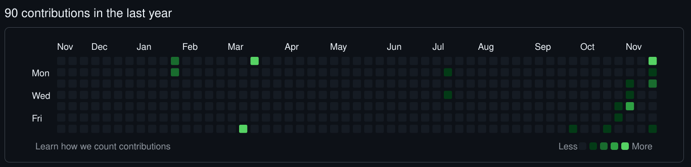

  
  
  
  
  

<a href="https://github.com/32KZ?tab=overview">
  <picture>
    <source media="(prefers-color-scheme: dark)" srcset="./assets/contributions-dark.svg" />
    <source media="(prefers-color-scheme: light)" srcset="./assets/contributions-light.svg" />
    
  </picture>
</a>

I build **Windows apps**, **automation systems**, and **Minecraft tools**, with a focus on reliability, security, and exactly what's needed.

🔥 **See cool shit → Think cool shit → Build cool shit.**

  
    
  
  
  
  
  

## SUPERNOVA

⚙️ The successor to **ZEKE-UI**.

<!-- Add the SUPERNOVA overview, features, and screenshots here. -->

## Minecraft

### ZEEK-PACKET — client tools

🎮 A **Minecraft 1.21.1 Meteor addon** that brings together useful tools from Autism Client and UIUtils, alongside my own custom modules.

### Plugins & server tooling

- **Paper/Spigot:** custom plugin development.
- **Permissions:** tooling around the LuckPerms ecosystem.
- **Performance & stability:** keeping servers running reliably.
- **Build tools & networking:** Gradle, Maven, and TCP/IP.

## Automation

**n8n + Docker** workflows, AI integrations, and automation built for production.

- Reusable workflow templates and credential-safe designs.
- Webhook and REST API integrations.
- OAuth authentication and PostgreSQL-backed workflows.

## Skillset

| Area | Tools & technologies |
| --- | --- |
| Languages | C#, Java, Python, JavaScript, TypeScript, HTML   |
| Desktop apps | Electron   |
| Minecraft | Paper/Spigot, Meteor addons, LuckPerms, Gradle, Maven   |
| Automation & data | n8n, REST APIs, webhooks, OAuth, PostgreSQL   |
| Infrastructure & networking | Docker, Linux, Nginx, GitHub Actions, TCP/IP   |

## Principles

- ✅ **Common sense.**
- ✅ **Put control in the end user's hands.**
- ✅ **I'm the dev.**

## Contact

- **Discord:** 32KZ
- **Email:** available on request.

## Older stuff

<strong>ZEKE-UI — the foundation for SUPERNOVA ✨✨✨✨</strong>

### Overview

A customisable desktop workspace inspired by **eDEX-UI** and **CoLateral**, with an integrated JARVIS-style assistant, themes, pop-out windows, and shortcuts for each widget.

Development slowed as I started repurposing ZEKE-UI into **SUPERNOVA**. These projects are private for now; I'd like to open-source them eventually.

### Features & design

- **14 widgets**, including files, a Monaco-powered code editor, project build tools, a task manager, terminals, and a global situation view.
- **Connected terminals:** Git Bash, WSL, Command Prompt, and PowerShell, linked to the active files widget.
- **Workspaces:** create, rename, reorder, and export as many as needed.
- **Modular widgets:** a structure designed for user-defined extensions.
- **NOVA AI:** voice or text control to orchestrate a ruflow swarm using a realtime speech model.
- **Startup splashes:** 10 random, configurable splashes that follow the persistent user theme.

### Mobile & XR direction

The original direction also included a mobile app for dispatching work, low-power Bluetooth headphone connectivity for always-in-ear support, and XR glasses for EDITH-style control.

### Development snapshots

The previous README referenced **v0.16.34** and later **v0.22.71**. These are historical version notes.

